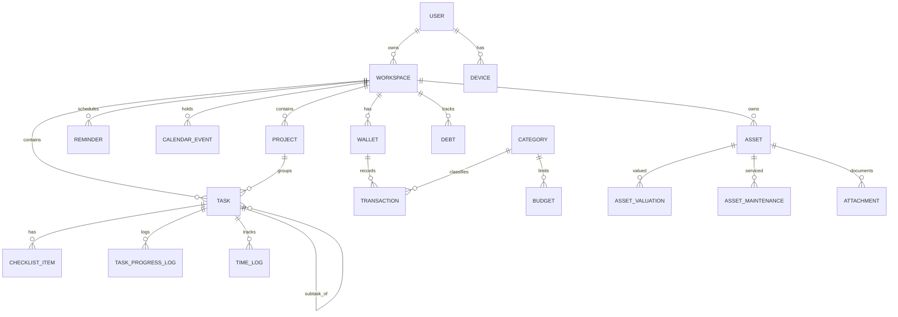

# PRD — Aplikasi Manajemen Kegiatan Harian, Keuangan & Aset Pribadi

**Nama Kode Produk:** `Axon Dayli`
**Platform:** Android (Flutter)
**Versi Dokumen:** 1.0 (Draft untuk review)
**Tanggal:** 18 November 2026
**Status:** Draft — menunggu persetujuan

---

## 1. Ringkasan Eksekutif

`Axon Dayli` adalah aplikasi Android untuk mengelola **kegiatan harian, jadwal pekerjaan, keuangan pribadi, dan aset** dalam satu tempat. Karakteristik utama:

- **Offline-first / hybrid storage** — data tersimpan permanen di HP (SQLite terenkripsi), lalu disinkronkan ke server saat internet tersedia. Aplikasi **tetap 100% fungsional tanpa internet**.
- **Workspace terpisah** — data **Perusahaan** dan **Pribadi** diisolasi total (bukan sekadar filter), sehingga laporan dan aset tidak pernah tercampur.
- **Monitoring progres pekerjaan** — progres tidak hanya status, tapi terukur (persentase, log progres, timeline, beban kerja).
- **Pencatatan keuangan profesional** — double-entry-lite, multi-wallet, kategori, budget, laporan arus kas, piutang/hutang.

**Tujuan satu baris:** menjadi "satu aplikasi" yang menggantikan kombinasi notes + kalender + spreadsheet keuangan + catatan aset.

---

## 2. Latar Belakang & Masalah

| Masalah | Dampak Saat Ini |
|---|---|
| Kegiatan tersebar di notes, WhatsApp, dan ingatan | Pekerjaan terlewat, deadline meleset |
| Progres pekerjaan tidak terukur | Tidak tahu mana yang mandek, sulit lapor atasan/klien |
| Keuangan pribadi dicatat manual di spreadsheet | Malas update, data tidak real-time, rawan salah hitung |
| Aset pribadi & perusahaan tercampur | Laporan keuangan tidak akurat, sulit audit |
| Sinyal internet tidak stabil (lapangan, perjalanan) | Aplikasi berbasis cloud sering gagal dipakai justru saat dibutuhkan |
| Pengingat tersebar di banyak aplikasi | Reminder tidak konsisten |

### Peluang
Pengguna tunggal (personal productivity + side business) belum terlayani aplikasi yang menggabungkan *task management* dengan *personal finance* dan *asset registry* secara offline-first. Sebagian besar aplikasi hanya menyelesaikan satu domain.

---

## 3. Tujuan & Metrik Keberhasilan

### 3.1 Tujuan Produk (Objectives)
1. **O1** — Pengguna dapat mencatat kegiatan & transaksi dalam **< 10 detik** per entri.
2. **O2** — Semua data dapat diakses **tanpa internet**, tanpa kehilangan data.
3. **O3** — Progres pekerjaan dapat dilihat sekilas dan diukur objektif.
4. **O4** — Pemisahan data Perusahaan vs Pribadi dijamin secara teknis, bukan sekadar kebiasaan.
5. **O5** — Pengguna tahu kondisi keuangan & aset kapan pun (dashboard, laporan).

### 3.2 Metrik (Key Results)

| Metrik | Target |
|---|---|
| Crash-free sessions | ≥ 99,5% |
| Sync success rate (delivery dalam 60 detik saat online) | ≥ 99% |
| Waktu buat transaksi (median, dari buka app) | ≤ 10 detik |
| Data loss akibat konflik sync | **0** (nol) |
| Retensi D7 / D30 | ≥ 60% / ≥ 35% |
| Pengguna mencatat ≥ 4 hari/minggu | ≥ 70% pengguna aktif |
| Ukuran APK (release, split per ABI) | ≤ 35 MB |

---

## 4. Persona & Use Case

### Persona Utama — "Parwanto", 30-an, profesional + side business
- Bekerja di perusahaan, juga mengelola kegiatan/aset sendiri.
- Mobilitas tinggi, sering di lokasi dengan sinyal lemah.
- Butuh cepat: buka app → lihat hari ini → catat → tutup.

### Use Case Kunci (ringkas)

| ID | Skenario |
|---|---|
| UC-01 | Pagi hari, buka app, lihat agenda hari ini + reminder, tandai selesai |
| UC-02 | Di lapangan tanpa sinyal, catat pengeluaran & progres pekerjaan |
| UC-03 | Sore hari, HP dapat sinyal, data otomatis tersinkron |
| UC-04 | Akhir bulan, lihat laporan keuangan pribadi & rekap progres pekerjaan |
| UC-05 | Switch ke workspace Perusahaan, cek nilai aset & biaya operasional |
| UC-06 | Dapat notifikasi deadline tugas yang belum selesai |
| UC-07 | Ganti HP baru, login, seluruh data kembali utuh |

---

## 5. Lingkup

### 5.1 In Scope (v1.0)
- Android (min SDK 24 / Android 7.0, target SDK terbaru)
- Workspace Pribadi & Perusahaan (multi-workspace, satu akun)
- Kegiatan/tugas + subtask + progres + timeline
- Kalender & jadwal
- Pengingat lokal (notifikasi) + pengingat berbasis deadline
- Keuangan pribadi: wallet, transaksi, kategori, budget, laporan, hutang/piutang
- Aset: registri aset, nilai, penyusutan sederhana, lampiran foto/dokumen
- Sinkronisasi dua arah (HP ⇄ server)
- Backup/export (CSV, JSON) & restore
- Keamanan: PIN/biometrik, enkripsi database lokal

### 5.2 Out of Scope (v1.0 — dicatat untuk roadmap)
- iOS / Web (arsitektur disiapkan, implementasi tidak)
- Kolaborasi multi-user / sharing workspace
- Sinkronisasi bank otomatis (open banking / scraping)
- OCR struk, voice input, AI assistant
- Investasi real-time (harga saham/kripto live)
- Multi-currency penuh (v1: IDR saja, field currency disiapkan)
- Widget homescreen (v1.1)

---

## 6. Arsitektur Sistem

### 6.1 Gambaran Tingkat Tinggi

```
┌─────────────────────────────────────────────┐
│              FLUTTER ANDROID                │
│                                             │
│  UI (Riverpod + go_router)                  │
│        │                                    │
│  Repository Layer  ← sumber kebenaran lokal │
│        │                                    │
│  Drift (SQLite + SQLCipher)  ←──────────┐   │
│        │                                │   │
│  Sync Engine (outbox + delta pull)      │   │
│        │                                │   │
│  WorkManager / Connectivity Listener ───┘   │
└────────────────┬────────────────────────────┘
                 │ HTTPS (REST + JSON)
┌────────────────▼────────────────────────────┐
│           BACKEND (Node.js)                 │
│  Fastify/NestJS + Zod validation            │
│  Auth (JWT access + refresh rotation)       │
│  Sync API (/sync/push, /sync/pull)          │
│  Prisma ORM                                 │
└────────────────┬────────────────────────────┘
                 │
        ┌────────▼────────┐
        │  PostgreSQL     │
        │  (dev: lokal)   │
        └─────────────────┘
```

### 6.2 Prinsip Arsitektur
1. **Local-first**: semua *read* & *write* dilayani database lokal. UI tidak pernah menunggu jaringan.
2. **Server = replika + multi-device + backup**, bukan sumber kebenaran tunggal.
3. **Append-only untuk data historis** (transaksi, log progres, valuasi aset) → tidak mungkin konflik.
4. **Identitas dibuat di client** (UUID v7) → bisa membuat data saat offline tanpa bentrok ID.
5. **Workspace sebagai batas isolasi** di lapisan query, API, dan UI.

### 6.3 Tech Stack

| Layer | Teknologi | Alasan |
|---|---|---|
| Mobile app | Flutter (Dart 3), Material 3 | Satu codebase, performa native, ekosistem matang |
| State management | Riverpod | Testable, tidak bergantung BuildContext |
| Routing | go_router | Deep link untuk notifikasi |
| DB lokal | **Drift** (SQLite) + `sqlcipher_flutter_libs` | Relasional (butuh join laporan), terenkripsi, query reaktif (stream) |
| Migrasi lokal | Drift schema versioning | Perlu untuk update app |
| Background sync | `workmanager` + `connectivity_plus` | Sync periodik & saat jaringan pulih |
| Notifikasi | `flutter_local_notifications` + `timezone` | Jadwal presisi, recurring |
| Keamanan lokal | `local_auth`, `flutter_secure_storage` | Biometrik + simpan token aman |
| Charts | `fl_chart` | Laporan & progress |
| Backend | Node.js 20 + **Fastify** (atau NestJS) | Ringan, cepat, TS first-class |
| ORM | **Prisma** | Skema deklaratif, migration, type-safe |
| DB server | **PostgreSQL 16** (lokal via Docker untuk dev) | JSONB, index kuat, andal |
| Validasi | Zod | Validasi request konsisten |
| Auth | JWT (access 15 mnt) + refresh token rotation | Standar, aman untuk mobile |
| Dev environment | Docker Compose (Postgres) + `prisma migrate dev` | Reproducible |

> Catatan: Prisma berjalan di **backend** (Node.js), bukan di dalam aplikasi Flutter. Flutter memakai Drift/SQLite. Ini penting agar tidak salah asumsi "Prisma di HP".

---

## 7. Model Data

### 7.1 Konvensi Umum (wajib untuk sync)
Semua tabel tersinkron memiliki kolom:

| Kolom | Tipe | Fungsi |
|---|---|---|
| `id` | TEXT (UUID v7) | Dibuat client, unik global |
| `workspace_id` | TEXT | Isolasi Pribadi/Perusahaan |
| `created_at` | BIGINT (epoch ms) | Waktu buat (client clock) |
| `updated_at` | BIGINT | Waktu ubah terakhir (client clock) |
| `server_updated_at` | BIGINT | Ditetapkan server, dipakai cursor pull |
| `deleted_at` | BIGINT NULL | Soft delete (tombstone) |
| `version` | INTEGER | Optimistic concurrency |
| `device_id` | TEXT | Asal perubahan terakhir |

### 7.2 Entitas

**Identitas & Workspace**
| Entitas | Atribut kunci |
|---|---|
| `User` | id, email, name, password_hash, timezone, currency (IDR), pin_hash |
| `Workspace` | id, user_id, type (`personal`\|`company`), name, color, icon, archived_at |
| `Device` | id, user_id, name, platform, last_seen_at, push_token |

**Kegiatan & Jadwal**
| Entitas | Atribut kunci |
|---|---|
| `Project` | id, workspace_id, name, description, color, status, start_date, due_date |
| `Task` | id, workspace_id, project_id?, parent_task_id?, title, description, status (`todo`\|`in_progress`\|`blocked`\|`done`\|`cancelled`), priority (1–4), progress (0–100), start_at, due_at, completed_at, estimated_minutes, actual_minutes, tags, is_recurring, recurrence_rule (RRULE) |
| `TaskProgressLog` | id, task_id, progress_before, progress_after, note, attachment_id?, occurred_at |
| `ChecklistItem` | id, task_id, title, is_done, order |
| `TimeLog` | id, task_id, started_at, ended_at, note |

**Reminder**
| Entitas | Atribut kunci |
|---|---|
| `Reminder` | id, workspace_id, entity_type (`task`\|`event`\|`transaction`\|`budget`\|`custom`), entity_id?, title, message, trigger_at, recurrence_rule?, channels (`local_push`), snooze_until, is_active, fired_at |

**Kalender**
| Entitas | Atribut kunci |
|---|---|
| `CalendarEvent` | id, workspace_id, title, location, start_at, end_at, all_day, recurrence_rule?, linked_task_id?, note |

**Keuangan**
| Entitas | Atribut kunci |
|---|---|
| `Wallet` | id, workspace_id, name, type (`cash`\|`bank`\|`ewallet`\|`credit`), initial_balance (BIGINT), currency, archived_at |
| `Category` | id, workspace_id, name, kind (`income`\|`expense`), parent_id?, icon, color |
| `Transaction` | id, workspace_id, wallet_id, category_id?, type (`income`\|`expense`\|`transfer`), amount (BIGINT), fee (BIGINT), transfer_group_id?, occurred_at, note, payee, attachment_id?, is_reconciled |
| `Budget` | id, workspace_id, category_id, period (`monthly`\|`weekly`\|`custom`), amount, start_date, end_date, rollover |
| `Debt` | id, workspace_id, counterparty, direction (`receivable`\|`payable`), principal, remaining, due_date, note, status |

> Uang disimpan sebagai **BIGINT Rupiah utuh** (bukan float/double) untuk menghindari galat pembulatan.

**Aset**
| Entitas | Atribut kunci |
|---|---|
| `Asset` | id, workspace_id, name, category (`vehicle`\|`property`\|`electronics`\|`investment`\|`equipment`\|`other`), purchase_date, purchase_price, current_value, depreciation_method (`none`\|`straight_line`\|`declining`), useful_life_months, salvage_value, status (`active`\|`sold`\|`lost`\|`maintenance`), serial_number, note |
| `AssetValuation` | id, asset_id, value, valued_at, source (`manual`\|`auto_depreciation`), note |
| `AssetMaintenance` | id, asset_id, title, cost, performed_at, next_due_at, note |
| `Attachment` | id, workspace_id, owner_type, owner_id, file_name, mime_type, size_bytes, local_path, remote_url, checksum |

**Sync & Audit**
| Entitas | Atribut kunci |
|---|---|
| `SyncOp` (outbox, lokal) | id, entity, entity_id, op (`upsert`\|`delete`), payload (JSON), created_at, attempts, last_error |
| `SyncState` (lokal) | key, value (mis. `last_pull_cursor`) |
| `AuditLog` (server) | id, user_id, device_id, entity, entity_id, action, changed_fields (JSONB), at |

### 7.3 ERD Ringkas



---

## 8. Strategi Sinkronisasi (Hybrid Storage)

### 8.1 Alur Kerja
1. **Write lokal** → tulis ke Drift + sisipkan `SyncOp` ke tabel outbox dalam **satu transaksi DB**.
2. **Push** → saat online, kirim batch `SyncOp` (maks 200/batch, gzip).
3. **Server apply** → validasi workspace ownership, cek `version` (optimistic lock), simpan, isi `server_updated_at`.
4. **Pull** → `GET /sync/pull?cursor=<server_updated_at>` mengembalikan perubahan sejak cursor → **apply ke lokal** → simpan cursor baru.

### 8.2 Resolusi Konflik
| Jenis data | Strategi |
|---|---|
| Data append-only (transaksi, log progres, valuasi) | Tidak pernah konflik — selalu ditambahkan |
| Field skalar (judul, catatan, nominal) | **Last-Write-Wins per field** berdasarkan `updated_at` + `device_id` tiebreaker |
| Status/prioritas tugas | LWW + catat di `AuditLog` |
| Hapus vs edit | Hapus menang jika `deleted_at` lebih baru; entitas di-*soft delete* 30 hari lalu dipurge |
| Konflik tak terduga | Simpan versi kalah ke tabel `SyncConflict` → tampilkan banner "Tinjau konflik" |

### 8.3 Perilaku Offline
- Semua fitur berjalan tanpa jaringan (termasuk laporan).
- Indikator status sync di AppBar: `Tersinkron` / `Menunggu (n)` / `Offline`.
- Retry dengan **exponential backoff** (5s → 30s → 2m → 10m → 30m, maks).
- Sync otomatis saat: app dibuka, app ke foreground, jaringan pulih, setiap 15 menit (WorkManager), dan setelah idle 3 detik pasca-edit (debounce).
- **Force sync** manual tersedia di Settings.

### 8.4 Skema Prisma (ilustrasi)

```prisma
model Task {
  id             String   @id
  workspaceId    String   @map("workspace_id")
  projectId      String?  @map("project_id")
  parentTaskId   String?  @map("parent_task_id")
  title          String
  description    String?
  status         TaskStatus @default(TODO)
  priority       Int      @default(2)
  progress       Int      @default(0)
  startAt        DateTime? @map("start_at")
  dueAt          DateTime? @map("due_at")
  completedAt    DateTime? @map("completed_at")
  createdAt      DateTime @map("created_at")
  updatedAt      DateTime @map("updated_at")
  serverUpdatedAt DateTime @default(now()) @map("server_updated_at")
  deletedAt      DateTime? @map("deleted_at")
  version        Int      @default(1)
  deviceId       String   @map("device_id")

  workspace Workspace @relation(fields: [workspaceId], references: [id])
  project   Project?  @relation(fields: [projectId], references: [id])
  parent    Task?     @relation("Subtasks", fields: [parentTaskId], references: [id])
  subtasks  Task[]    @relation("Subtasks")
  logs      TaskProgressLog[]

  @@index([workspaceId, serverUpdatedAt])
  @@index([workspaceId, status, dueAt])
  @@index([dueAt])
}
```

---

## 9. Requirement Fungsional

Format: **FR-xx** — *story* — *acceptance criteria* (AC).

### Epic A — Onboarding & Workspace

**FR-A1 Registrasi/Login**
- Daftar via email + password (min 8 karakter), atau login.
- AC: Token tersimpan aman; sesi bertahan setelah app ditutup; refresh otomatis tanpa logout paksa saat token expired.

**FR-A2 Pembuatan Workspace**
- Saat first-run dibuat workspace `Pribadi` otomatis; pengguna dapat menambah `Perusahaan`.
- AC: Minimal 1 workspace; nama unik per user; workspace punya warna/ikon pembeda.

**FR-A3 Workspace Switcher**
- Tombol di AppBar/sidebar untuk berpindah workspace; indikator konteks selalu terlihat.
- AC: Perpindahan < 300 ms (data lokal); seluruh list/dashboard/laporan mengikuti workspace aktif; badge warna konsisten di semua halaman.

### Epic B — Kegiatan & Progres

**FR-B1 Hari Ini (Today)**
- Ringkasan: agenda hari ini, tugas jatuh tempo, transaksi hari ini, reminder berikutnya, progres proyek aktif.
- AC: Tampil < 1 detik dari cache; tersedia aksi cepat "tambah tugas" & "catat transaksi".

**FR-B2 CRUD Tugas**
- Buat/ubah/hapus tugas dengan judul, deskripsi, proyek, prioritas, tanggal mulai & tenggat, estimasi durasi, tag, lampiran.
- AC: Form bisa disimpan tanpa internet; validasi lokal; tersedia undo (snackbar 5 detik).

**FR-B3 Subtask & Checklist**
- Tugas dapat punya subtask (hierarki maks 2 level) dan checklist ringan.
- AC: Centang checklist memperbarui progres tugas induk secara otomatis.

**FR-B4 Progres Terukur**
- Progres 0–100%. Bisa diisi manual (slider) atau otomatis dari subtask/checklist.
- Setiap perubahan progres tercatat di `TaskProgressLog` (nilai lama, baru, catatan, waktu).
- AC: Riwayat progres tampil sebagai timeline; perubahan progres bekerja offline.

**FR-B5 Status & Board**
- Status: `todo`, `in_progress`, `blocked`, `done`, `cancelled`. Tersedia tampilan Kanban (drag antar kolom) dan List.
- AC: Drag pada board mengubah status + mencatat waktu perubahan; kolom `blocked` meminta alasan singkat.

**FR-B6 Timeline & Beban Kerja**
- Tampilan timeline per proyek (rentang tanggal) dan ringkasan beban kerja per minggu (jumlah & jam).
- AC: Tugas yang lewat tenggat ditandai merah; konflik jadwal terdeteksi pada hari yang sama.

**FR-B7 Recurring Task**
- Dukungan pengulangan harian/mingguan/bulanan/custom (RRULE terbatas).
- AC: Menyelesaikan instance membuat instance berikutnya; pengecualian (skip 1 instance) didukung.

**FR-B8 Quick Capture**
- FAB global → input satu baris dengan parsing ringan (mis. `#proyek besok 14:00`).
- AC: Minimal mendeteksi tanggal & jam; hasil bisa diedit sebelum simpan.

### Epic C — Kalender & Pengingat

**FR-C1 Kalender**
- Tampilan bulan/minggu/hari yang menggabungkan tugas, event, dan reminder.
- AC: Tap tanggal → daftar item; tap item → detail; navigasi geser antar bulan.

**FR-C2 Event**
- CRUD event (judul, lokasi, mulai, selesai, all-day, catatan, tautan ke tugas).
- AC: Event lintas tengah malam ditangani benar.

**FR-C3 Notifikasi Pengingat**
- Reminder relatif (`-10 mnt`, `-1 jam`, `-1 hari`) atau absolut; snooze 5/15/60 mnt; recurring.
- AC: Notifikasi tetap muncul dalam mode pesawat; izin `POST_NOTIFICATIONS` diminta dengan penjelasan; `SCHEDULE_EXACT_ALARM` diminta hanya bila perlu; setelah reboot jadwal dipulihkan.

**FR-C4 Eskalasi Deadline**
- Pengingat otomatis untuk tugas belum selesai: H-1, hari-H, dan setiap 24 jam setelah lewat (maks 3×).
- AC: Dapat dimatikan per tugas; tidak spam (maks 1 notifikasi/24 jam/tugas).

### Epic D — Keuangan Pribadi

**FR-D1 Wallet**
- Kelola wallet (tunai, bank, e-wallet, kartu kredit) dengan saldo awal.
- AC: Saldo dihitung dari transaksi (derived), bukan diedit manual; koreksi via transaksi penyesuaian.

**FR-D2 Transaksi**
- Catat pemasukan, pengeluaran, dan transfer antar wallet (biaya admin opsional).
- Field: nominal, kategori, wallet, tanggal, catatan, penerima, lampiran struk.
- AC: Simpan ≤ 3 tap dari FAB; input nominal memakai keypad numerik dengan pemisah ribuan; nominal 0 ditolak; transfer membuat 2 baris terkait `transfer_group_id`.

**FR-D3 Kategori**
- Kategori default (Makan, Transport, Tagihan, Gaji, dll.) + custom, mendukung subkategori.
- AC: Kategori terpakai tidak bisa dihapus (hanya diarsipkan).

**FR-D4 Budget**
- Budget per kategori per periode, dengan progres pemakaian.
- AC: Notifikasi saat 80% & 100% terpakai (maks 1× per periode per kategori).

**FR-D5 Piutang & Hutang**
- Catat pinjaman/utang, jatuh tempo, sisa, dan pembayaran parsial.
- AC: Pembayaran otomatis mengurangi sisa & membuat transaksi terkait.

**FR-D6 Laporan**
- Ringkasan bulanan: pemasukan, pengeluaran, selisih, top kategori, tren 6 bulan, arus kas per wallet.
- AC: Filter periode & workspace; ekspor CSV; angka cocok dengan data lokal (diverifikasi di test).

**FR-D7 Transaksi Berulang**
- Template transaksi berulang (gaji, sewa, langganan) dengan auto-generate + konfirmasi.
- AC: Tidak pernah membuat duplikat untuk periode yang sama.

### Epic E — Aset

**FR-E1 Registri Aset**
- CRUD aset per workspace dengan kategori, tanggal & harga beli, nilai kini, nomor seri, lokasi, foto, dokumen.
- AC: Aset perusahaan tidak muncul di workspace pribadi (dan sebaliknya) — diuji dengan query-level test.

**FR-E2 Valuasi**
- Riwayat nilai aset (manual) + penyusutan otomatis (garis lurus / saldo menurun).
- AC: Nilai kini = valuasi terakhir; penyusutan dihitung per bulan; grafik riwayat nilai tersedia.

**FR-E3 Perawatan**
- Jadwal servis/perawatan dengan biaya, tanggal, dan pengingat berikutnya.
- AC: Pengingat otomatis dibuat bila `next_due_at` diisi.

**FR-E4 Status Aset**
- `active`, `maintenance`, `sold`, `lost`. Penjualan mencatat harga jual & realisasi untung/rugi.
- AC: Aset terjual tidak dihitung di total nilai aktif.

**FR-E5 Ringkasan Kekayaan**
- Total nilai aset per workspace + komposisi per kategori + tren.
- AC: Ringkasan Pribadi dan Perusahaan terpisah, tidak pernah dijumlahkan tanpa label.

### Epic F — Data, Keamanan, Pengaturan

**FR-F1 Enkripsi & Kunci**
- Database lokal terenkripsi (SQLCipher); kunci di Keystore.
- PIN 6 digit + biometrik (opsional, bisa diaktifkan).
- AC: Setelah 5 percobaan PIN salah → jeda bertahap; app blur di app switcher.

**FR-F2 Backup & Restore**
- Export JSON penuh + CSV per entitas; import dengan validasi & preview.
- AC: Export bisa dibagikan ke Drive/WhatsApp; import tidak menimpa data kecuali dipilih.

**FR-F3 Sync Control**
- Status sync, waktu terakhir, antrean, force sync, dan log error yang bisa dibaca.
- AC: Error ditampilkan dalam bahasa manusia, bukan stack trace.

**FR-F4 Pengaturan**
- Zona waktu, awal minggu, format tanggal, mata uang, tema (light/dark/system), ukuran teks.
- AC: Perubahan format berlaku langsung di seluruh app.

---

## 10. Requirement Non-Fungsional

| Kategori | Requirement |
|---|---|
| Performa | Cold start ≤ 2,5 s (mid-range device); buka list 10.000 transaksi ≤ 500 ms (pagination + index); scroll 60 fps |
| Offline | 100% fitur inti berfungsi tanpa jaringan; tidak ada spinner yang memblokir UI karena jaringan |
| Ukuran | APK release ≤ 35 MB (split ABI); R8 + resource shrink |
| Baterai | Sync background ≤ 1% per jam; tanpa wake-lock berlebihan |
| Keamanan | TLS 1.2+; password hash Argon2id; JWT rotasi; enkripsi at-rest (HP & server); validasi kepemilikan workspace di setiap endpoint |
| Privasi | Tidak ada analytics pihak ketiga di v1; crash log opsional & opt-in; data keuangan tidak dikirim ke layanan eksternal |
| Aksesibilitas | Kontras WCAG AA; target sentuh ≥ 48 dp; dukung TalkBack untuk alur utama; font scale 200% tidak memotong layout |
| Lokalisasi | Bahasa Indonesia (default); string terpusat untuk menambah bahasa lain; format Rupiah `Rp1.234.567` |
| Reliabilitas | Migrasi DB lokal tidak boleh menghilangkan data; rollback aman untuk 2 versi skema |
| Observability | Structured log server; request ID; metrik sync (success, latency, conflict rate) |

---

## 11. UI/UX

### 11.1 Prinsip Desain
1. **Satu layar = satu keputusan.** Jangan tampilkan semua sekaligus.
2. **Offline itu normal**, bukan error. Jangan pernah menampilkan dialog "tidak ada koneksi" untuk aksi yang bisa disimpan lokal.
3. **Kecepatan menang.** FAB selalu terjangkau; input nominal & tanggal tanpa keyboard penuh.
4. **Warna = konteks.** Workspace Perusahaan vs Pribadi dibedakan lewat aksen warna yang konsisten (mis. biru vs hijau).
5. **Data finansial mudah dipindai.** Angka rata kanan, tabular figures, warna semantik (hijau masuk / merah keluar) — bukan warna sebagai satu-satunya penanda (aksesibilitas).

### 11.2 Informasi Arsitektur (Navigasi)

```
Bottom Navigation (5 tab)
├── 1. Hari Ini (dashboard)
├── 2. Kegiatan  → List | Board | Timeline
├── 3. Kalender
├── 4. Keuangan   → Ringkasan | Transaksi | Budget | Laporan
└── 5. Aset       → Daftar | Nilai | Perawatan

Drawer (kiri) : workspace switcher, Pengaturan, Sync, Backup, Tentang
FAB kontekstual per tab: + Tugas / + Transaksi / + Aset
```

### 11.3 Layar Utama (wireframe deskriptif)

**Dashboard "Hari Ini"**
- Header: sapaan + tanggal + chip workspace + indikator sync.
- Kartu ringkas: `Tugas hari ini 3/5`, `Pengeluaran hari ini Rp250.000`, `Nilai aset Rp…`.
- Timeline agenda (jam → item) dengan checkbox selesai.
- `Perlu perhatian`: tugas telat, budget > 80%, reminder terdekat.

**Detail Tugas**
- Judul, chip prioritas/status, progres (slider + angka), subtask, deskripsi, lampiran, riwayat progres (timeline), tombol "Tambah progres" & "Tandai selesai".

**Keuangan**
- Ringkasan: saldo total, masuk/keluar bulan ini, grafik tren.
- Daftar transaksi dikelompokkan per tanggal, dengan header total harian.
- Input cepat: nominal (keypad), kategori (grid ikon), wallet, tanggal (default hari ini), simpan.

### 11.4 Komponen & Gaya
- Material 3, dynamic color opsional, radius 16, elevation minimal.
- Tipografi: 1 font sans (mis. Inter/Plus Jakarta Sans) — 6 skala.
- Ikon: Material Symbols.
- Empty state selalu memberi aksi (bukan halaman kosong).
- Skeleton loading untuk operasi > 300 ms (jarang, karena lokal).

---

## 12. Struktur Repositori (rencana)

```
dailypilot/
├── apps/
│   ├── mobile/                  # Flutter
│   │   ├── lib/
│   │   │   ├── core/            # theme, router, di, error, utils
│   │   │   ├── data/
│   │   │   │   ├── local/       # drift, dao, migrations
│   │   │   │   ├── remote/      # api client, dto
│   │   │   │   ├── sync/        # outbox, puller, resolver
│   │   │   │   └── repositories/
│   │   │   ├── features/
│   │   │   │   ├── today/ tasks/ calendar/ finance/ assets/ settings/
│   │   │   └── main.dart
│   │   └── test/
│   └── server/                  # Node.js + Prisma
│       ├── prisma/schema.prisma
│       ├── src/
│       │   ├── routes/ (auth, workspaces, tasks, finance, assets, sync)
│       │   ├── services/
│       │   └── lib/ (prisma client, auth, validation)
│       └── docker-compose.yml   # postgres:16 untuk dev lokal
└── docs/
    └── PRD-Aplikasi-Kegiatan-Harian.md
```

---

## 13. API Kontrak (ringkas)

| Method | Endpoint | Fungsi |
|---|---|---|
| POST | `/auth/register` | Daftar |
| POST | `/auth/login` | Login → access + refresh |
| POST | `/auth/refresh` | Rotasi refresh token |
| GET | `/workspaces` | Daftar workspace |
| POST | `/sync/push` | Kirim batch operasi (idempotent, `opId`) |
| GET | `/sync/pull?cursor=` | Ambil perubahan sejak cursor |
| GET | `/reports/summary?from=&to=&workspaceId=` | Ringkasan laporan (opsional, untuk device baru) |
| GET/POST/PATCH/DELETE | `/tasks`, `/transactions`, `/assets`, … | CRUD (dipakai non-sync flow bila online) |

Prinsip: **push/pull adalah jalur utama**; endpoint CRUD dipakai untuk kasus khusus & debugging. Semua endpoint wajib memvalidasi `workspace_id` milik user.

---

## 14. Roadmap

| Fase | Fokus | Durasi estimasi | Deliverable |
|---|---|---|---|
| **P0 — Fondasi** | Repo, CI, auth, Drift schema, sync engine dasar, theme | 2 minggu | Login + sync 1 entitas (Task) terbukti end-to-end |
| **P1 — MVP** | Today, Task CRUD, subtask, progres, kalender, reminder lokal | 3 minggu | Bisa dipakai harian untuk kegiatan & jadwal |
| **P2 — Keuangan** | Wallet, transaksi, kategori, budget, laporan, piutang | 3 minggu | Modul keuangan lengkap |
| **P3 — Aset** | Registri, valuasi, penyusutan, perawatan, penjualan | 2 minggu | Aset Pribadi/Perusahaan terpisah |
| **P4 — Polish** | Backup/restore, aksesibilitas, performa, onboarding, beta | 2 minggu | Rilis internal / closed beta |
| **P5 — v1.0** | Perbaikan beta, Play Store listing, monitoring | 1 minggu | Rilis publik |

Total ± **13 minggu** untuk 1 developer (part-time: ± 5–6 bulan).

---

## 15. Risiko & Mitigasi

| Risiko | Dampak | Mitigasi |
|---|---|---|
| Bug sinkronisasi → data hilang/duplikat | Tinggi | Idempotensi `opId`, soft delete, test integrasi dua device, `SyncConflict` + audit log |
| Jam perangkat tidak akurat (clock skew) | Sedang | Server tetap menetapkan `server_updated_at`; peringatkan jika skew > 5 menit |
| Exact alarm dibatasi OEM (Xiaomi/Oppo) | Sedang | Panduan izin per OEM, fallback `inexactAllowWhileIdle`, tampilkan "Reminder mungkin terlambat" |
| Kompleksitas fitur melampaui waktu | Sedang | MVP ketat (P1), finance & asset bertahap, cut scope widget/OCR |
| Kebocoran data keuangan | Tinggi | Enkripsi at-rest lokal & server, tanpa third-party analytics, otentikasi biometrik |
| Migrasi DB lokal gagal saat update | Tinggi | Test migrasi tiap versi, backup otomatis sebelum migrasi |
| Kelelahan input manual | Sedang | Quick capture, template, transaksi berulang, default cerdas |

---

## 16. Asumsi & Pertanyaan Terbuka

**Asumsi**
1. Satu pengguna per akun (single-tenant user), multi-device didukung.
2. Mata uang utama IDR; field `currency` disiapkan untuk masa depan.
3. Backend Node.js + Fastify + Prisma + PostgreSQL, dijalankan lokal via Docker untuk pengembangan.
4. Workspace Perusahaan bersifat pribadi (bukan kolaborasi tim) pada v1.
5. Tidak ada monetisasi pada v1.

**Pertanyaan terbuka (perlu keputusan)**
1. Apakah workspace Perusahaan nantinya butuh **multi-user** (tim)? → mempengaruhi skema permission.
2. Perlu **PIN terpisah** untuk workspace Perusahaan (proteksi tambahan)?
3. Apakah perlu **lampiran tersimpan di server** sejak v1, atau cukup lokal + backup manual?
4. Metode penyusutan: cukup garis lurus, atau perlu saldo menurun & custom?
5. Target minimum Android: 7.0 (SDK 24) atau 8.0 (SDK 26)?
6. Perlu modul **utang perusahaan vs pribadi** yang terpisah laporannya, atau cukup workspace?

---

## 17. Definisi

| Istilah | Arti |
|---|---|
| Workspace | Ruang data terisolasi: `Pribadi` atau `Perusahaan` |
| Offline-first | Aplikasi mengutamakan penyimpanan lokal; jaringan bersifat opsional |
| Outbox | Tabel antrean operasi lokal yang belum terkirim ke server |
| Delta sync | Sinkronisasi hanya perubahan sejak titik waktu tertentu (cursor) |
| Tombstone | Penanda hapus (soft delete) yang disinkronkan agar penghapusan tidak "hidup lagi" |
| UUID v7 | UUID berbasis waktu, aman dibuat offline, urut secara kronologis |
| RRULE | Standar iCalendar untuk aturan pengulangan |
| LWW | Last-Write-Wins, strategi resolusi konflik sederhana |

---

*Dokumen ini adalah draft. Silakan tandai bagian yang perlu diubah — terutama bagian 16 (pertanyaan terbuka) — sebelum masuk ke tahap desain teknis detail dan implementasi.*
